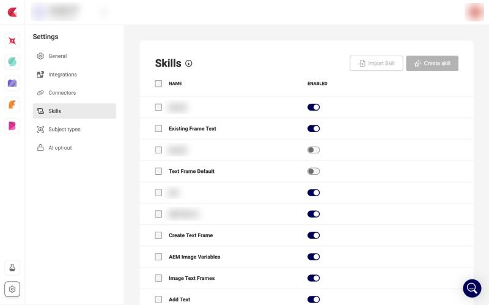
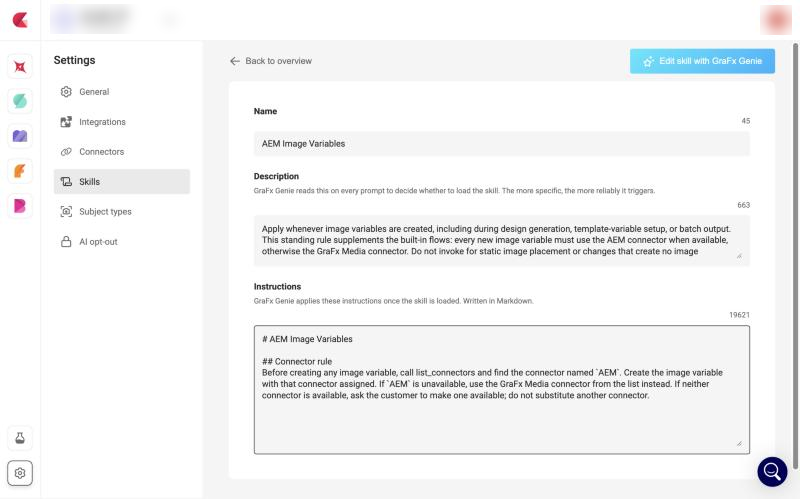

# Manage Skills

A [skill](/CHILI-GraFx/concepts/skills/) is a reusable instruction that tells GraFx Genie how to carry out a kind of task in your environment. Skills are managed **per environment** by a Subscription Admin or Environment Admin, see [roles](/CHILI-GraFx/users/roles/). Each environment can hold up to **10** skills.

This page covers managing skills in the platform. For how skills are used, what to put in them and worked examples, see [Custom skills for the Design Agent](/GraFx-Genie/design-agent/skills/).

## Open the Skills page

In the CHILI GraFx platform, make sure the correct environment is selected, then open **Settings**. In the Settings sidebar, select **Skills** (between Connectors and Subject types).

{.screenshot-full}

The page lists the skills defined for the environment, each with an **Enabled** toggle.

## Create a skill

1. Click **Create skill**.
2. Describe what the skill should do, in your own words. The info icon next to the title explains how skills work.
3. Click **Create Skill**. GraFx Genie generates the name, description and Markdown instructions and opens the skill's detail page.
4. Review the result and adjust the fields where needed.

Alternatively, fill in the **Name**, **Description** and **Instructions** fields yourself. All three are required.

| Field | Limit | Purpose |
|---|---|---|
| **Name** | 64 characters | What the skill is for. |
| **Description** | 1,024 characters | When the skill applies. GraFx Genie reads this on every prompt to decide whether to load the skill. |
| **Instructions** | 20,000 characters, Markdown | What GraFx Genie does once the skill is loaded. |

**Create skill** is disabled once the environment holds 10 skills.

## Edit a skill

Select a skill in the list to open its detail page. Edit the fields directly, or click **Edit skill with GraFx Genie**, describe the change, and let GraFx Genie rewrite the skill.

{.screenshot-full}

## Enable or disable a skill

Use the **Enabled** toggle in the list. A disabled skill is kept but not used by GraFx Genie.

GraFx Genie reads the skills when a template is opened. Reopen the template to pick up a new, changed, enabled or disabled skill.

## Export and import skills

- **Export**: open the actions menu on a skill and choose **Export** to download it as a JSON file.
- **Import**: click **Import Skill** next to **Create skill** and select a JSON file. The imported skill opens on its detail page.

Use this to build and test skills in a [Sandbox](/CHILI-GraFx/concepts/sandbox/) environment and move them to production. Import is one file at a time and respects the limit of 10 skills.

## Delete a skill

Open the actions menu on a skill and choose **Delete**, or select several skills with the row checkboxes and delete them together. Confirm to apply.
