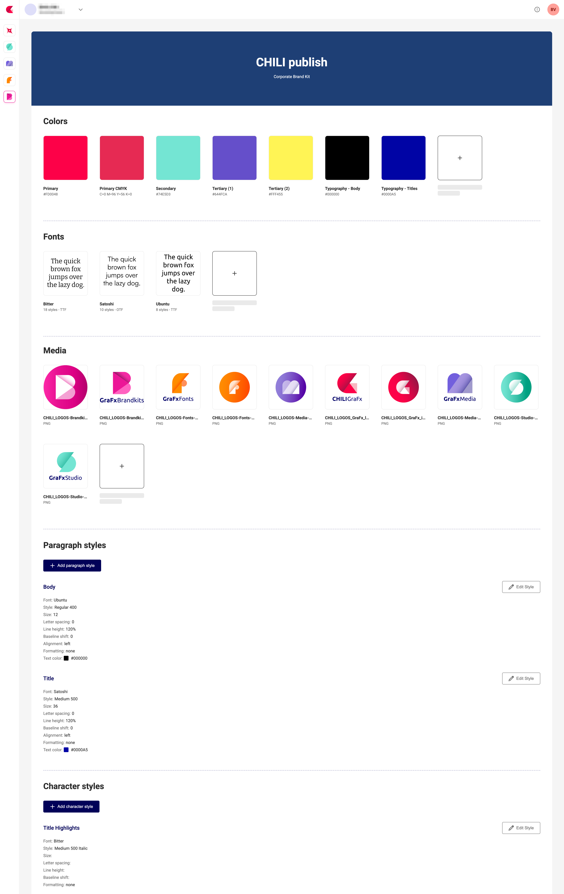

# Elements  

Within each Brand Kit you can manage:

| Element               | Description                                              |
|-----------------------|----------------------------------------------------------|
| **Colors**            | Named swatches (e.g. Primary, Secondary) in RGB/CMYK/HEX/...     |
| **Fonts**             | OpenType/TrueType fonts to use in GraFx Studio templates |
| **Media**             | Logos or other image assets                              |
| **Paragraph styles**  | Font, size, spacing, alignment for paragraphs            |
| **Character styles**  | Font, size, formatting for inline text                   |
| **Components**        | Reusable design elements from GraFx Studio (a price tag, a promo badge) that belong to the brand |

Elements are defined on the Brand Kit's default [theme](/GraFx-Brand-Kits/concepts/themes/) and can be overridden per theme. Components are the exception: they have no theme variants and are managed on the default theme only.

!!! info "Brand Kit elements and design tokens"
    If you know [design tokens](https://en.wikipedia.org/wiki/Design_system#Design_tokens){target="_blank"} from design systems: a design token is an atomic value (`color.primary = #0055FF`, `color.primary.print = cmyk(100, 60, 0, 0)`, `font.size.body = 16px`). Brand Kit elements sit one level above. Colors come closest to tokens — named values defined once and reused — while a paragraph or character style combines multiple design decisions (font family, size, weight, line height) into one reusable style. [Themes](/GraFx-Brand-Kits/concepts/themes/) then map different values onto the same elements, much like token modes.

    Design tokens (atomic values) → Brand Kit elements (styles) → Themes (value mapping) → Templates

    So while we don't use the token terminology, a Brand Kit is fully compatible with a token-based design system.

{.screenshot-full}

## Descriptions

Colors, media, paragraph styles, character styles and components can carry an optional **description**: a short, free-text explanation of what the element is for, such as "primary logo, for light backgrounds", "accent color, reserved for calls to action" or "body copy, for long-form text". A name identifies an element; a description tells you when to use it.

Descriptions serve two readers:

- **Designers** who use the Brand Kit in GraFx Studio and need to know which of three reds is the one for prices.
- **The [GraFx Genie Design Agent](/GraFx-Genie/design-agent/)**, which designs and adapts templates from the Brand Kit. The agent reads every description when it picks a color, an image, a text style or a component, so a described Brand Kit is what turns "add a promo badge in the top-right corner" into the right badge, in the right color, with the right text style. Without descriptions the agent still works from the kit, but it has to guess the purpose of each element from its name and properties.

A description belongs to the element itself rather than to a [theme](/GraFx-Brand-Kits/concepts/themes/). You set it on the default theme, and every theme of the Brand Kit shares it; on other themes the description is read-only. Fonts have no description: describe a font's use through the styles that apply it.

You add descriptions on the Brand Kit detail page (see [Update a Brand Kit](/GraFx-Brand-Kits/guides/edit/#describe-an-element)) or through the Brand Kit endpoints of the Environment API. Guidance on writing descriptions that steer the Design Agent well, with examples per element type, is on [Brand Kit descriptions for the Design Agent](/GraFx-Genie/design-agent/brand-kit-descriptions/).
