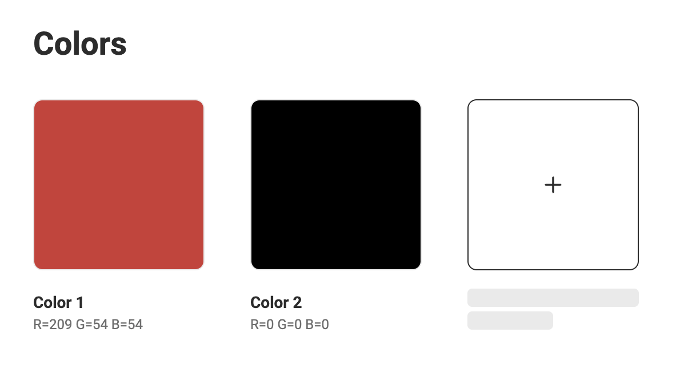
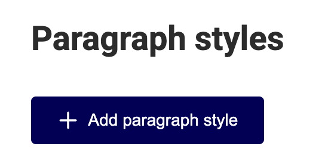
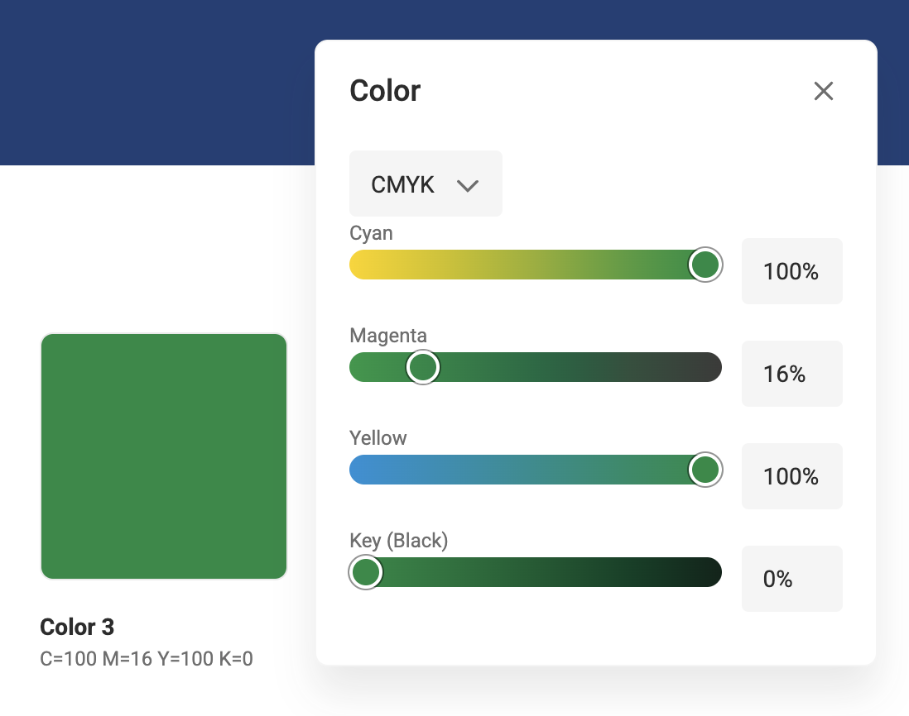
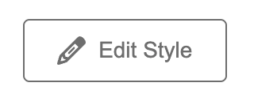
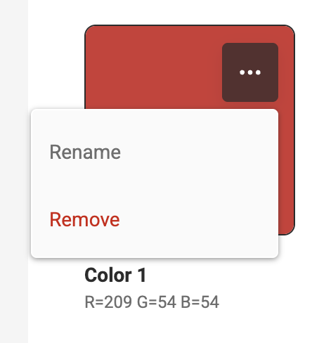

# Update a Brand Kit

On the Brand Kit detail page:

!!! info "Editing themes"
    Your edits apply to the theme selected in the theme bar at the top of the page. On the default theme you edit the Brand Kit itself; on any other theme, changes are saved as overrides on that theme. See [Manage themes](/GraFx-Brand-Kits/guides/themes/).

## Add an element

- Click the “+” in the empty tile for Colors, Fonts & Media.

{.screenshot}

- Click on the "Add" button for Paragraph styles or Character styles.  

{.screenshot}

- Fill in the required fields or add items.  

{.screenshot}

## Edit an element

- Colors: Click the color tile and edit the values
- Fonts: Only add and remove fonts is possible
- Media: Add, remove, or replace assets using the "..." context menu. If an asset has been deleted from GraFx Media, the Brand Kit shows an *"Image not available"* placeholder — use the context menu to replace or delete it.
- Paragraph- and Character styles: click the "Edit Style" button

{.screenshot}

## Describe an element

Colors, media, paragraph styles, character styles and components have a **Description** text area next to their preview. Use it to say when the element is meant to be used: "price and discount color, never for body copy", "logo for dark backgrounds", "headline style, max two lines".

- Descriptions can only be edited on the default theme. On other themes the field is shown read-only, since a theme changes an element's value, not its purpose.
- Templates that use the Brand Kit pick up new descriptions through [Brand Kit sync](/GraFx-Studio/guides/brandkits/#keep-a-brand-kit-in-sync).

!!! tip "Descriptions guide the Design Agent"
    The [GraFx Genie Design Agent](/GraFx-Genie/design-agent/) reads these descriptions whenever it designs or changes a template from this Brand Kit. A well-described kit is the single biggest factor in how on-brand the agent's work is. See [Brand Kit descriptions for the Design Agent](/GraFx-Genie/design-agent/brand-kit-descriptions/) for what to write.

## Add a component

Components let the Brand Kit carry the brand's reusable design elements alongside its colors and styles. In the **Components** section, click "+" and pick a component from the environment's component library; a duplicate gets a unique name. Give it a description that says where it goes and which of its fields map to which template variables.

Components have no theme variants: add, describe and remove them on the default theme. Removing a component from the Brand Kit only removes it from the kit, not from the environment.

## Remove an element

- Click the "..." menu and select **Remove**

{.screenshot}
