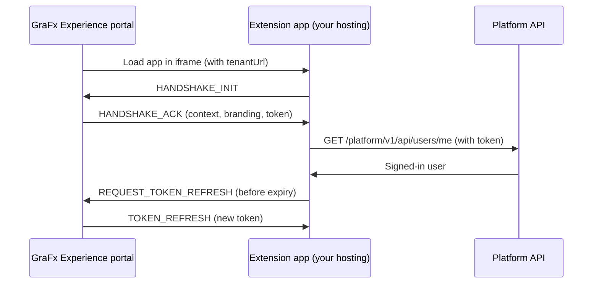

# Tutorial: Hello world extension

In this tutorial, you build your first GraFx Experience extension: a page in the portal that greets the signed-in user by name. Along the way, you touch every part of an extension — the app, the Extension SDK, hosting, the local extension, and the page in a space.

What you will build:

- A small web app that connects to GraFx Experience with the Extension SDK
- A call to the platform API that reads the signed-in user
- A page that shows "Hello, {first name}!" in the branding of your portal

## How it works

The extension is a small web app on your own hosting. When a user opens its page in a space, GraFx Experience loads the app in an iframe. The app asks the platform who is signed in, and shows "Hello, {first name}!" in the colors and font of your portal, together with the space, page, and locale it runs in.

The app communicates with GraFx Experience in two ways. The Extension SDK handles both.

**With the portal, through browser messages.** GraFx Experience adds its own address to the iframe URL as `tenantUrl`. The SDK only accepts messages from that address. When the app starts, the SDK sends a handshake request (`HANDSHAKE_INIT`) to the portal. The portal answers (`HANDSHAKE_ACK`) with:

- The context of the page — space, page, and locale
- The branding of the portal — primary color, font, and corner radius
- A short-lived token (JWT) for the signed-in user, limited to the permissions of the extension

When the token is about to expire, the SDK asks the portal for a new one in the same way.

**With the platform API, over HTTPS.** With that token, the app calls the API directly — in this tutorial, `/platform/v1/api/users/me`. The SDK adds the token and the identifier of your installation to every request. The call runs as the signed-in user, and only within the permissions of the extension.



In short: the portal provides the context and the access, your hosting runs the app, and the API does what the user is allowed to do — within the permissions of the extension.

## Before you start

- Admin access to the **Admin Console** of your GraFx Experience installation
- Node.js 20.19 or later, and npm
- A place to host static files over HTTPS

!!! info "You choose where your extension runs"
    Your extension app runs on hosting of your choice — your own, your customer's, or a third party's. For now, CHILI GraFx does not host extension apps. See [Hosting your extension](/GraFx-Developers/grafx-experience/overview/#hosting-your-extension).

## Step 1: Create the project

Create a new Vite project with TypeScript, and add the Extension SDK:

```bash
npm create vite@latest hello-world-extension -- --template vanilla-ts
cd hello-world-extension
npm install
npm install @kadanza/extension-sdk
```

Vite creates some sample files. Delete `src/counter.ts` and the `src/assets` folder — you replace the rest in the next step.

## Step 2: Write the page

### The HTML

Replace the contents of `index.html`:

```html
<!doctype html>
<html lang="en">
  <head>
    <meta charset="UTF-8" />
    <meta name="viewport" content="width=device-width, initial-scale=1.0" />
    <title>Hello world extension</title>
  </head>
  <body>
    <main id="app">
      <p>Connecting to GraFx Experience…</p>
    </main>
    <script type="module" src="/src/main.ts"></script>
  </body>
</html>
```

### The styling

Replace the contents of `src/style.css`. The CSS variables hold default values; the app overwrites them with the branding of your portal.

```css
:root {
  --primary-color: #1a73e8;
  --font-family: system-ui, sans-serif;
  --border-radius: 8px;
}

body {
  margin: 0;
  padding: 24px;
  font-family: var(--font-family);
  color: #1f1f1f;
}

.card {
  max-width: 480px;
  padding: 24px;
  border: 2px solid var(--primary-color);
  border-radius: var(--border-radius);
}

h1 {
  margin-top: 0;
  color: var(--primary-color);
}

dt {
  font-weight: bold;
}
```

### The code

Replace the contents of `src/main.ts`:

```typescript
import { createExtensionSDK, type DesignTokens } from "@kadanza/extension-sdk";
import "./style.css";

const app = document.querySelector<HTMLElement>("#app")!;

// 1. Create the SDK once for the whole app
const sdk = createExtensionSDK();

// 2. Use the portal's branding, when the portal sends it
function applyDesignTokens(tokens: DesignTokens | null) {
  const style = document.documentElement.style;
  if (tokens?.primaryColor) style.setProperty("--primary-color", tokens.primaryColor);
  if (tokens?.fontFamily) style.setProperty("--font-family", tokens.fontFamily);
  if (tokens?.borderRadius) style.setProperty("--border-radius", tokens.borderRadius);
}

// Small helper to add a label and value to a list
function addDetail(list: HTMLElement, label: string, value: string | null | undefined) {
  const dt = document.createElement("dt");
  dt.textContent = label;
  const dd = document.createElement("dd");
  dd.textContent = value ?? "—";
  list.append(dt, dd);
}

async function start() {
  try {
    // 3. Connect to GraFx Experience: the handshake returns the context and a scoped token
    const { extensionDetails, designTokens } = await sdk.connect({
      authTokenAutoRefresh: true,
    });
    applyDesignTokens(designTokens);

    // 4. Call the platform API as the signed-in user
    const user = await sdk.apiCall<{ firstName: string }>("/platform/v1/api/users/me");

    // 5. Render the result
    const card = document.createElement("div");
    card.className = "card";

    const heading = document.createElement("h1");
    heading.textContent = `Hello, ${user.firstName}!`;

    const intro = document.createElement("p");
    intro.textContent = "This page is served by your own extension.";

    const details = document.createElement("dl");
    addDetail(details, "Space ID", extensionDetails?.spaceId);
    addDetail(details, "Page ID", extensionDetails?.pageId);
    addDetail(details, "Locale", extensionDetails?.locale);

    card.append(heading, intro, details);
    app.replaceChildren(card);
  } catch (error) {
    // connect() fails when the app is not opened inside GraFx Experience
    const message = document.createElement("p");
    message.textContent =
      "Could not connect to GraFx Experience. Open this page from the portal, not directly in the browser.";
    app.replaceChildren(message);
    console.error(error);
  }
}

// 6. Clean up when the page goes away
window.addEventListener("pagehide", () => sdk.destroy());

start();
```

What the code does:

1. **Creates the SDK.** `createExtensionSDK()` returns one shared instance for the app.
2. **Applies the branding.** The handshake can include **design tokens** — the primary color, font, and corner radius of your portal. Every token is optional, so the code only uses the ones it receives.
3. **Connects to GraFx Experience.** `connect()` performs the handshake with the portal. It returns the context of the page (`extensionDetails`), the design tokens, and a scoped token for API calls. With `authTokenAutoRefresh: true`, the SDK renews that token before it expires.
4. **Calls the platform API.** `apiCall()` adds the authorization headers for you. The call runs as the signed-in user, within the [API permissions](/GraFx-Developers/grafx-experience/create-local-extension/#api-permissions) of the extension.
5. **Shows the result.** The page greets the user and lists the space, page, and locale it runs in. The code uses `textContent` rather than HTML strings, so data from the API is never interpreted as markup.
6. **Cleans up.** `destroy()` removes the listeners and timers of the SDK when the page closes.

### The build configuration

Create `vite.config.ts` in the project root:

```typescript
import { defineConfig } from "vite";

export default defineConfig({
  // Relative asset paths, so the app works on any hosting path
  base: "./",
});
```

## Step 3: Build the app

```bash
npm run build
```

Vite type-checks the code and writes the app to the `dist` folder: an `index.html` file and an `assets` folder. That folder is the complete extension app.

## Step 4: Host the app

Upload the contents of `dist` to your hosting. Any service that serves static files over HTTPS works — for example, a cloud storage bucket behind a CDN, or a static site hosting service.

Note the HTTPS address where `index.html` is served, for example `https://extensions.example.com/hello-world/`. You need it in the next step.

!!! tip "Check the URL"
    Open the address in your browser. You should see the message *Could not connect to GraFx Experience*. That is expected: the app only connects when the portal embeds it.

## Step 5: Register the local extension

1. In the **Admin Console**, go to **Extensions** > **Installed**.
2. Select **Create local extension**.
3. Fill in the extension:

    | Field | Value |
    |---|---|
    | **Extension key** | `hello-world` |
    | **Name** | `Hello World` |
    | **Permissions** | The permission to read users — search the field for *users* |
    | **SDK authentication** | On |
    | **Experience pages** | On |
    | **Base URL** | The HTTPS address of your app, from Step 4 |
    | **Pages** | One page, with title `Hello world` and path `/` |
    | **Active** | On |

4. Save the extension.

See [Create a local extension](/GraFx-Developers/grafx-experience/create-local-extension/) for the description of every field.

## Step 6: Add the page to a space

1. Open the space in the page editor.
2. In the page tree, click **Add page**.
3. Select **Hello World page**.
4. Open **Page settings** to set the title, navigation name, and access of the page.
5. Save and publish the space.

## Step 7: Try it

Open the page in the portal. You see your extension inside GraFx Experience:

- A card in the colors of your portal
- "Hello, {your first name}!"
- The space ID, page ID, and locale of the page

### If it does not work

| What you see | What to check |
|---|---|
| **Hello World page** is missing in the page editor | The extension is **Active**, and **Experience pages** is on. |
| The page stays empty or shows an error from the browser | The **Base URL** uses HTTPS and points to the folder that holds `index.html`. |
| *Could not connect to GraFx Experience* inside the portal | **SDK authentication** is on. Check the browser console for details. |
| The card does not appear, and the console shows a failed API call | The extension has the permission to read users. |

## Next steps

You now have a working extension. From here:

- Build a larger app with React and hash routing — see [Build with the Extension SDK](/GraFx-Developers/grafx-experience/extension-sdk/).
- Call other endpoints — see the [Experience Extension API](/GraFx-Developers/grafx-experience/api-reference/).
- Check the user's role before showing admin-only actions — see [Role values](/GraFx-Developers/grafx-experience/authentication/#role-values).
