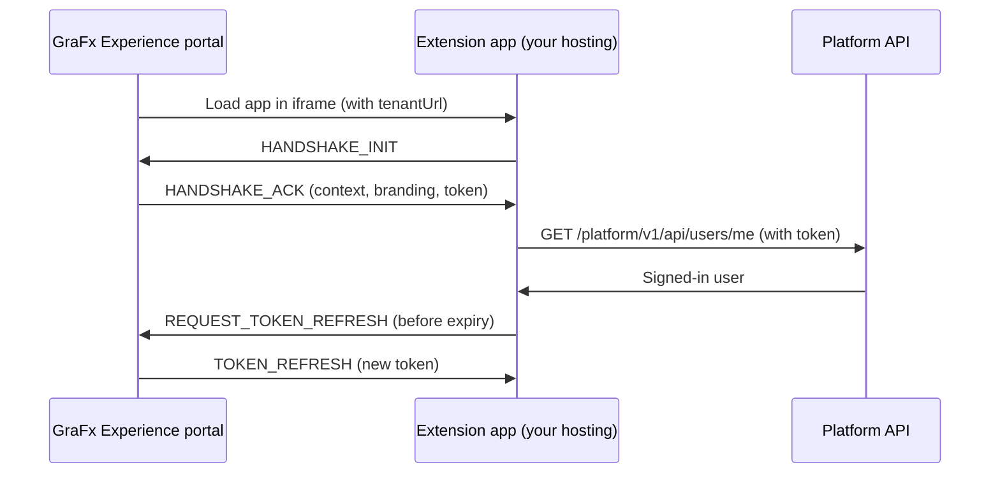

# Tutorial: Hello world extension

In this tutorial, you build your first GraFx Experience extension: a page in the portal that greets the signed-in user by name. You go through every part of an extension: the app, the Extension SDK, hosting, the local extension, and the page in a space.

You will build:

- A small web app that connects to GraFx Experience with the Extension SDK
- An API call that gets the signed-in user
- A page that shows "Hello, {first name}!" in your portal's branding

## How it works

The extension is a small web app on your own hosting. When a user opens its page in a space, GraFx Experience loads the app in an iframe. The app asks the platform who is signed in, then shows "Hello, {first name}!" in your portal's colors and font, along with the space, page, and locale.

The app talks to GraFx Experience in two ways. The Extension SDK handles both.

**With the portal, through browser messages.** GraFx Experience adds its own address to the iframe URL as `tenantUrl`, and the SDK only accepts messages from that address. When the app starts, the SDK sends a handshake request (`HANDSHAKE_INIT`). The portal answers (`HANDSHAKE_ACK`) with:

- The page context: space, page, and locale
- The portal's branding: primary color, font, and corner radius
- A short-lived token (JWT) for the signed-in user, limited to the extension's permissions

Before the token expires, the SDK asks the portal for a new one.

**With the platform API, over HTTPS.** The app uses the token to call the API directly. In this tutorial, that's `/platform/v1/api/users/me`. The SDK adds the token and your installation's ID to every request. Calls run as the signed-in user and stay within the extension's permissions.



In short: the portal provides the context and access, your hosting runs the app, and the API only does what the user and the extension are allowed to do.

## Before you start

- Admin access to the **Admin Console**
- Node.js 20.19 or later, and npm
- A place to host static files over HTTPS

!!! info "You choose where your extension runs"
    You host the extension app yourself, or your customer or a third party hosts it. For now, CHILI GraFx does not host extension apps. See [Hosting your extension](/GraFx-Developers/grafx-experience/overview/#hosting-your-extension).

## Step 1: Create the project

Create a Vite project with TypeScript and add the Extension SDK:

```bash
npm create vite@latest hello-world-extension -- --template vanilla-ts
cd hello-world-extension
npm install
npm install @kadanza/extension-sdk
```

Delete the sample files `src/counter.ts` and the `src/assets` folder. You replace the other files in the next step.

## Step 2: Write the page

### The HTML

Replace the contents of `index.html`:

```html
<!doctype html>
<html lang="en">
  <head>
    <meta charset="UTF-8" />
    <meta name="viewport" content="width=device-width, initial-scale=1.0" />
    <title>Hello world extension</title>
  </head>
  <body>
    <main id="app">
      <p>Connecting to GraFx Experience…</p>
    </main>
    <script type="module" src="/src/main.ts"></script>
  </body>
</html>
```

### The styling

Replace the contents of `src/style.css`. The CSS variables are defaults. The app replaces them with your portal's branding.

```css
:root {
  --primary-color: #1a73e8;
  --font-family: system-ui, sans-serif;
  --border-radius: 8px;
}

body {
  margin: 0;
  padding: 24px;
  font-family: var(--font-family);
  color: #1f1f1f;
}

.card {
  max-width: 480px;
  padding: 24px;
  border: 2px solid var(--primary-color);
  border-radius: var(--border-radius);
}

h1 {
  margin-top: 0;
  color: var(--primary-color);
}

dt {
  font-weight: bold;
}
```

### The code

Replace the contents of `src/main.ts`:

```typescript
import { createExtensionSDK, type DesignTokens } from "@kadanza/extension-sdk";
import "./style.css";

const app = document.querySelector<HTMLElement>("#app")!;

// 1. Create the SDK once for the whole app
const sdk = createExtensionSDK();

// 2. Use the portal's branding, when the portal sends it
function applyDesignTokens(tokens: DesignTokens | null) {
  const style = document.documentElement.style;
  if (tokens?.primaryColor) style.setProperty("--primary-color", tokens.primaryColor);
  if (tokens?.fontFamily) style.setProperty("--font-family", tokens.fontFamily);
  if (tokens?.borderRadius) style.setProperty("--border-radius", tokens.borderRadius);
}

// Small helper to add a label and value to a list
function addDetail(list: HTMLElement, label: string, value: string | null | undefined) {
  const dt = document.createElement("dt");
  dt.textContent = label;
  const dd = document.createElement("dd");
  dd.textContent = value ?? "-";
  list.append(dt, dd);
}

async function start() {
  try {
    // 3. Connect to GraFx Experience: the handshake returns the context and a token
    const { extensionDetails, designTokens } = await sdk.connect({
      authTokenAutoRefresh: true,
    });
    applyDesignTokens(designTokens);

    // 4. Call the platform API as the signed-in user
    const user = await sdk.apiCall<{ firstName: string }>("/platform/v1/api/users/me");

    // 5. Show the result
    const card = document.createElement("div");
    card.className = "card";

    const heading = document.createElement("h1");
    heading.textContent = `Hello, ${user.firstName}!`;

    const intro = document.createElement("p");
    intro.textContent = "This page is served by your own extension.";

    const details = document.createElement("dl");
    addDetail(details, "Space ID", extensionDetails?.spaceId);
    addDetail(details, "Page ID", extensionDetails?.pageId);
    addDetail(details, "Locale", extensionDetails?.locale);

    card.append(heading, intro, details);
    app.replaceChildren(card);
  } catch (error) {
    // connect() fails when the app is not opened inside GraFx Experience
    const message = document.createElement("p");
    message.textContent =
      "Could not connect to GraFx Experience. Open this page from the portal, not directly in the browser.";
    app.replaceChildren(message);
    console.error(error);
  }
}

// 6. Clean up when the page closes
window.addEventListener("pagehide", () => sdk.destroy());

start();
```

What the code does:

1. **Creates the SDK.** `createExtensionSDK()` returns one shared instance.
2. **Applies the branding.** The portal can send **design tokens**: primary color, font, and corner radius. Each one is optional, so the code only uses what it gets.
3. **Connects.** `connect()` does the handshake and returns the page context (`extensionDetails`), the design tokens, and a token for API calls. With `authTokenAutoRefresh: true`, the SDK renews the token before it expires.
4. **Calls the API.** `apiCall()` adds the authorization headers. The call runs as the signed-in user, within the extension's [API permissions](/GraFx-Developers/grafx-experience/create-local-extension/#api-permissions).
5. **Shows the result.** The page greets the user and lists the space, page, and locale. It uses `textContent` instead of HTML strings, so API data is never treated as markup.
6. **Cleans up.** `destroy()` removes the SDK's listeners and timers when the page closes.

### The build configuration

Create `vite.config.ts` in the project root:

```typescript
import { defineConfig } from "vite";

export default defineConfig({
  // Relative asset paths, so the app works on any hosting path
  base: "./",
});
```

## Step 3: Build the app

```bash
npm run build
```

Vite checks the code and writes the app to the `dist` folder: an `index.html` file and an `assets` folder. That's your whole extension app.

## Step 4: Host the app

Upload the contents of `dist` to your hosting. Any service that serves static files over HTTPS works, such as a cloud storage bucket with a CDN or a static site host.

Write down the HTTPS address of `index.html`, for example `https://extensions.example.com/hello-world/`. You need it in the next step.

!!! tip "Test the address"
    Open the address in your browser. You should see *Could not connect to GraFx Experience*. That's expected: the app only connects when the portal loads it.

## Step 5: Register the local extension

1. In the **Admin Console**, go to **Extensions** > **Installed**.
2. Select **Create local extension**.
3. Fill in:

    | Field | Value |
    |---|---|
    | **Extension key** | `hello-world` |
    | **Name** | `Hello World` |
    | **Permissions** | The permission to read users (search for *users*) |
    | **SDK authentication** | On |
    | **Experience pages** | On |
    | **Base URL** | Your app's HTTPS address from Step 4 |
    | **Pages** | One page, with title `Hello world` and path `/` |
    | **Active** | On |

4. Save.

For details on each field, see [Create a local extension](/GraFx-Developers/grafx-experience/create-local-extension/).

## Step 6: Add the page to a space

1. Open the space in the page editor.
2. In the page tree, click **Add page**.
3. Select **Hello World page**.
4. In **Page settings**, set the title, navigation name, and access.
5. Save and publish the space.

## Step 7: Try it

Open the page in the portal. You should see:

- A card in your portal's colors
- "Hello, {your first name}!"
- The space ID, page ID, and locale

### If it doesn't work

| What you see | What to check |
|---|---|
| **Hello World page** is missing in the page editor | The extension is **Active** and **Experience pages** is on. |
| The page stays empty or shows a browser error | The **Base URL** uses HTTPS and points to the folder with `index.html`. |
| *Could not connect to GraFx Experience* in the portal | **SDK authentication** is on. Check the browser console for details. |
| No card, and the console shows a failed API call | The extension has the permission to read users. |

## Next steps

- Build a larger app with React and hash routing: [Build with the Extension SDK](/GraFx-Developers/grafx-experience/extension-sdk/)
- Call other endpoints: [Experience Extension API](/GraFx-Developers/grafx-experience/api-reference/)
- Show admin-only actions based on the user's role: [Role values](/GraFx-Developers/grafx-experience/authentication/#role-values)
