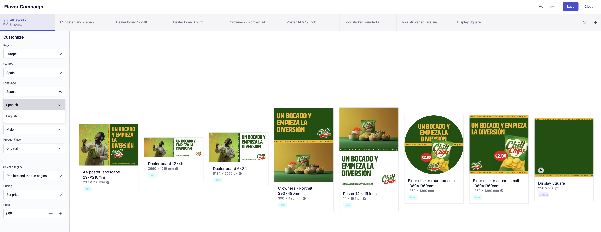

# Edit a project

This page explains how to personalize the layouts in your project.

## The editing experience

When you open a project, the editing experience shows:

- **Layout tabs** along the top — one tab for each layout in your project, plus an **All layouts** tab
- **Customize panel** on the left — all editable variables for the selected tab
- **Canvas** on the right — a live preview of the layout(s) updating as you make changes

{.screenshot-full}

## Editing all layouts at once

The **All layouts** tab is selected by default. Changes made here apply to every layout in your project simultaneously.

Use this to set values that are consistent across all formats — for example, region, language, tagline, or product.

## Editing a single layout

Click an individual layout tab to switch to that layout. Changes made in this view apply only to that specific layout and do not affect the others.

This is useful when you need to make an exception — for example, a different price point on a specific print format, or a different crop on a social media layout.

## Types of variables

The Customize panel shows all the variables available in the template. Depending on how the template was built in GraFx Studio, these can include:

- **Dropdown (select)** — choose from a predefined list of options (e.g. Region, Language, Product Flavor, Tagline)
- **Text** — enter free text (e.g. a headline or product name)
- **Number** — enter a numeric value (e.g. price)
- **Image** — replace an image by uploading a file or selecting from the media library

When you change a variable, all affected layouts are highlighted in the layout tabs so you can see exactly what will change.

## Adding layouts

You can add more layouts to your project after it has been created. Click the **+** icon in the upper right of the editing experience to open the layout selector and choose additional layouts.

Layouts already in your project are greyed out and cannot be selected again.

## Layout options

Click the **...** context menu next to a layout tab to access additional options:

- **Rename** — give the layout a custom name within this project
- **Duplicate** — create a copy of the layout in the project
- **Remove** — remove the layout from the project
- **Download** — download only this layout, in one of its formats (see [Download from the editor](#download-from-the-editor))

## Saving your work

Click **Save** to save your changes. Your project is stored on the Projects page and can be reopened at any time.

Click **Close** to exit the editing experience without saving the latest changes.

## Download from the editor

You can download your work without leaving the editor. There are two places to start a download:

| Where | What you get |
|---|---|
| **Download** in the title bar, next to **Save** | The whole project: every layout of the format group you pick (**Print** or **Digital**), whichever tab is open |
| **Download** in the **...** menu of a layout tab | Only that layout, in one of its formats |

A download with one file arrives as that file. A download with several files arrives as one ZIP file, named after the project.

- **Unsaved changes are saved first.** If the save fails or you cancel it, the download does not start.
- **You can keep editing.** A notification shows that the download has started, and another one with a **Download** button when the file is ready. The file is also listed on the [Downloads](../manage-projects/#downloads) tab.
- **Same options as the Projects page.** The formats you see, and whether you can download at all, are the same as on the project card. They depend on your user group and the template's workflow settings. When the template version has expired, download is not available.
- **Projects with one layout** don't show layout tabs. Use **Download** in the title bar.

If some layouts of a ZIP could not be generated, the ZIP holds the finished files and a warning says how many are missing.

!!! tip
    You can undo and redo changes using the arrow buttons in the toolbar before saving.
