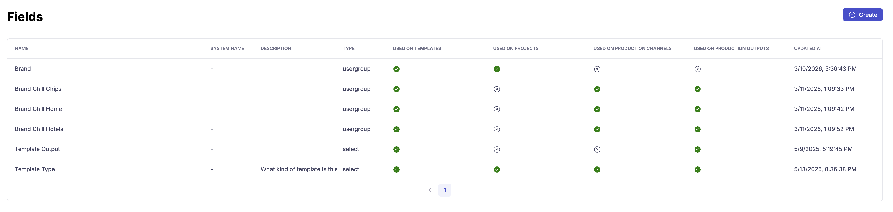

# Manage fields

This guide explains how to create fields and assign them to templates, projects, production channels, and outputs.

See [Fields](../../concepts/fields/) for a conceptual explanation of what fields are and how they work.

## Before you start

- You need admin access to GraFx Experience.

## Create a field

In the GraFx Experience general settings, go to **Fields** and click **New field**. Fill in:

| Setting | Description |
|---|---|
| Name | The field name as shown in the admin console and, where applicable, in the portal (e.g. "Template Type", "Template Access") |
| Description | Short explanation of what the field controls |
| Type | **Select** for a list of options, or **User Group** for access control |
| Used on | Select one or more: Template, Project, Production channel, Production output |
| Required | A checkbox next to each **Used on** option. Off by default. See [Make a field required on templates](#make-a-field-required-on-templates). |

Click **Save** to create the field.

{.screenshot-full}

!!! note
    Fields in use cannot be deleted. To remove a field, first remove it from all templates, projects, and channels where it is assigned.

## Add options to a Select field

After creating a Select field, open it and add the available options — for example, "Employer Branding", "Campaign", "Social Media" for a "Template Type" field. These options will be available to admins when assigning the field to a template.

## Assign a field to a template

Open a template in the GraFx Experience admin. On the **General** tab, the **Field values** section lists every field that is used on templates. Set the value directly on the field's row.

- For **Select** fields: choose one or more options from the predefined list.
- For **User Group** fields: select the user groups that should have access to this template.

Use **Clear** to remove a value. Click **Save** to apply.

Fields that are required on templates are labelled **Required** and can't be removed from the template.

## Make a field required on templates

Make a field required when every template must have a value for it, for example a channel or a campaign.

Open the field, and next to **Template** under **Used on**, select **Required**. Click **Save**.

From then on:

- **New templates** open with a row for the field, labelled **Required**. The row is empty, or holds the field's default value.
- **A template without a value can't be set to Active.** The error names the fields that are missing a value. This applies to templates that are Inactive, Expired or that need configuration.
- **An active template can't be saved** when a required value is removed.
- **Saving a template that is not active, and publishing a version, still work** without the value. Set the value before you activate the template.
- **Templates that are already active stay active.** End users see no difference. The next time an admin opens the template, a banner names the missing fields and empty rows are added. These rows are only saved when you click **Save**; opening the template never changes it.

!!! note
    **Required** is enforced on templates. On projects, production channels and production outputs, the setting is saved but not enforced.

## Configure field visibility on the campaigns page

To make a Select field available as a filter on the campaigns page, the field must be flagged as **Used on template** when it was created. The field then becomes available in the campaigns page widget configuration.

See [Configure the campaigns page](../configure-campaigns-page/) for instructions on enabling filters.

## Assign a field to a project

Fields marked as **Used on project** appear in the project overview. They can be used to filter the projects list and to display metadata on project cards.

To assign a field to a project, open the relevant template and enable the field for projects. The field value from the template is inherited by projects created from it.
