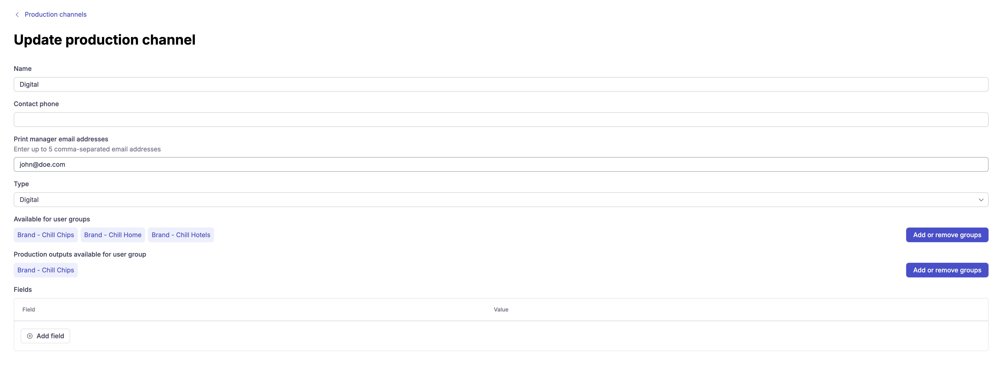

# Set up a production channel

This guide explains how to create a production channel in the CHILI GraFx extension and make it available to end users.

See [Production channels](../../concepts/production-channels/) for a conceptual explanation of what production channels are.

## Before you start

- You need access to the CHILI GraFx extension admin console in GraFx Experience.
- User groups must be set up if you want to restrict channel access.

## Step 1: Create a production channel

In the extension admin console, go to **Production Channels** and click **New production channel**. Fill in:

| Field | Description |
|---|---|
| Name | The channel name as shown to end users (e.g. "Printer West", "Digital Distribution") |
| Type | Select **Print** or **Digital** |
| Contact phone | Phone number of the production contact |
| Contact email | Email address of the production contact |
| Available for user groups | Which user groups can see and use this channel |
| Production outputs available for user group | Which outputs from this channel are visible to specific groups |

Click **Save** to create the channel.

{.screenshot-full}

## Step 2: Add custom fields (optional)

If you need to capture additional order information — such as a cost center or internal reference — you can add custom fields to the channel. These fields appear when a user places an order via this channel.

## Step 3: Configure output settings (optional)

In **Settings → Production output settings**, you can configure how production outputs are generated. These settings apply to all production channels.

| Setting | Description |
|---|---|
| Production output reference prefix | Up to 5 alphanumeric characters, automatically added to all order references generated through a channel |
| Default PDF output setting | The [output setting](/GraFx-Studio/concepts/output-settings/) from your CHILI GraFx environment used for production output PDFs. Options configured in that setting, such as outlined text or crop marks, are applied to every PDF sent to a production partner. If none is selected, production PDFs are generated with the environment's default PDF settings. |
| Default PDF VDP output setting | The PDF output setting used when the project's template has an [output data source](/GraFx-Studio/concepts/connectors-data/#two-ways-to-use-a-data-connector). Select a PDF output setting that has **Data source** enabled, so a batch of PDFs is produced, one per record. |

The dropdowns list the PDF output settings of the connected CHILI GraFx environment. If a setting you created recently is missing, clear the GraFx API cache under **Settings → Environment settings** (see [Connect the extension to CHILI GraFx](../connect-to-chili-grafx/#refreshing-after-changes-in-chili-grafx)).

!!! note
    Project downloads already use the output settings configured on the template. The default output settings above only affect **production outputs** — files generated when a user sends a project to a production channel.

## Step 4: Verify

Place a test order from a project using this channel. Confirm that the channel appears for the correct user groups and that the order details are captured correctly.

## Editing an existing channel

From the Production Channels overview, select **Edit** from the context menu next to a channel. You can update the name, contact details, type, user group access, and custom fields.
