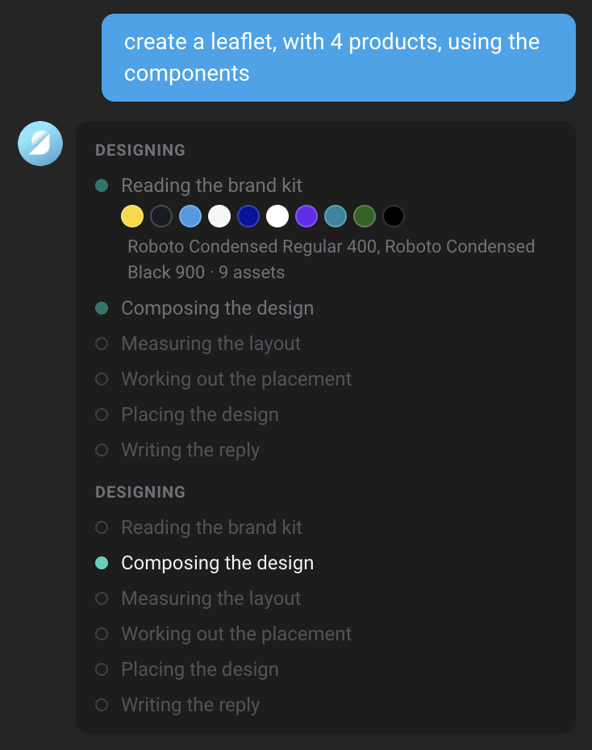
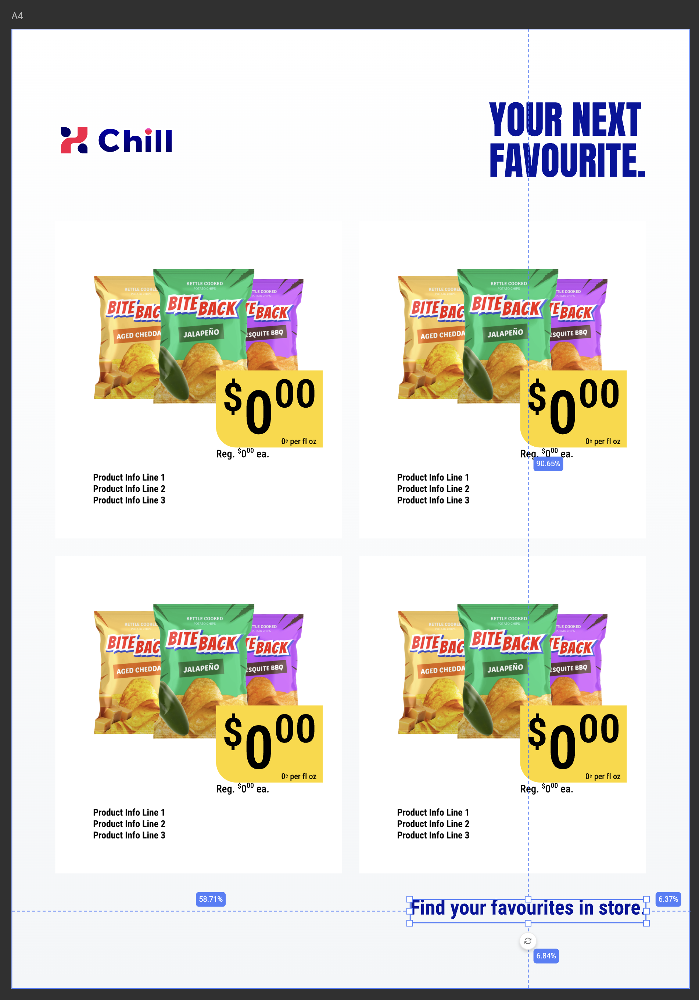

# Guide: design from scratch with the Design Agent

With a well-described Brand Kit, the [Design Agent](/GraFx-Genie/design-agent/) can compose a page from a sentence. This guide builds a leaflet page for a meat-section promotion, then adds a web banner from the same template and prepares both for weekly production.

## Before you start

Of the [three ways to start](/GraFx-Genie/design-agent/#three-ways-to-start), designing from a description needs at least the second: a Brand Kit with descriptions. The kit does the heavy lifting:

- **Colors** with descriptions that say their role (brand, price, text, background).
- **Paragraph styles** for at least headline, body, price and legal copy, each described.
- **Media**: the logo (described per background) and a few lifestyle images described by the occasion they fit.
- **Components** for the repeating elements (a promo slot, a discount badge), described with where they go and which fields map to which variables.
- Optional: [custom skills](/GraFx-Genie/design-agent/skills/) for your campaign formats and arrangement rules.

The [grocery retail example](/GraFx-Genie/design-agent/brand-kit-descriptions/#example-a-grocery-retail-kit) on the descriptions page is exactly this kit.

Then:

1. Create a new template in GraFx Studio.
2. [Import the Brand Kit](/GraFx-Studio/guides/brandkits/#import-a-brand-kit).
3. Open the Design Agent from the GraFx Genie button at the bottom of the left sidebar.

A template with no colors and no text styles cannot be designed on; the agent will say so.

## 1. Describe the page

> Create a leaflet page, A4 portrait with 3 mm bleed, with five promo slots, a lifestyle image in the background, a headline at the top and a footer with the disclaimer. Users must be able to edit all elements.

Watch the stages in the chat: **brand** (gathering the kit, its descriptions and the layout presets), **compose** (planning the page), **measure** (rendering text to make sure it fits), **placement** and **place** (putting the frames on the layout), then the reply. The result is a regular GraFx Studio layout: the lifestyle image in an image frame filled with the asset whose description matched "meat" or "barbecue", the headline in the *Headline* style, five *Promo slot* component frames in a grid, the disclaimer in *Legal* in the footer, and text and image variables for everything you asked to be editable.

{.screenshot}

{.screenshot-full}

If the layout size or intent you asked for differs from the current root layout, the agent applies it before placing.

## 2. Iterate in conversation

Each follow-up is a new turn, undoable on its own:

> Add the brand logo top-left.

> Make the headline two lines maximum and move the promo slots down by 10 mm.

> Use the barbecue lifestyle image instead.

> Add a discount badge on the first promo slot.

Look at the canvas after each one. When something is not what you meant, ++ctrl+z++ and rephrase; when it is nearly right, drag it into place by hand. The agent does not mind either.

## 3. Add a second format

> Add a vertical web banner, 300 × 600 px, digital static, with only one promo slot and without the lifestyle image.

The agent adds a child layout with that size and intent, keeps the elements that make sense for it (logo, headline, one promo slot) and hides the rest on that layout. Ask for the arrangement you want if the default is not it ("stack everything, logo on top").

## 4. Prepare for production

> Connect this template to the *Weekly offers* data source and match the columns to the variables.

The agent lists the deployed data connectors as chips, configures the one you pick, matches columns to variables by name and asks what to do with columns that have no variable yet. Switch to Run Mode to step through records.

From here the template works two ways: the brand team produces the weekly leaflet page and banners in batch, and field marketers self-serve banners from the same Design System in [GraFx Experience](/GraFx-Experience/), on-brand because every element came from the kit.

## Making it repeatable

Designing from scratch is where results vary most between runs: the agent is composing, not following a layout you drew. Two things narrow the variation:

- **Describe the structure, not just the content.** "Five promo slots in a 2-column grid in the bottom 60 % of the page, headline in the top 15 %, image behind everything" leaves less to interpret than "a leaflet page".
- **Put your standard page structures in a custom skill.** A skill called "Leaflet page structure" with the grid, the margins and the order of elements means the next brief can be "create a leaflet page for the bakery promotion" and land in the same place every time. See [custom skills](/GraFx-Genie/design-agent/skills/).

## Related

- [Prepare your template](/GraFx-Genie/design-agent/template-setup/#set-up-for-designing-from-scratch)
- [Brand Kit descriptions](/GraFx-Genie/design-agent/brand-kit-descriptions/)
- [What you can ask](/GraFx-Genie/design-agent/commands/#generate-a-design)
