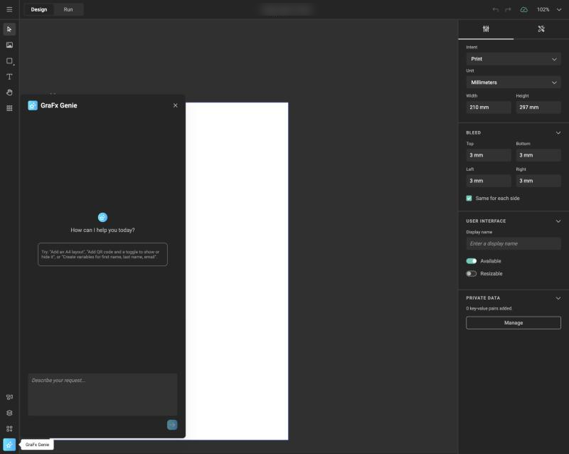
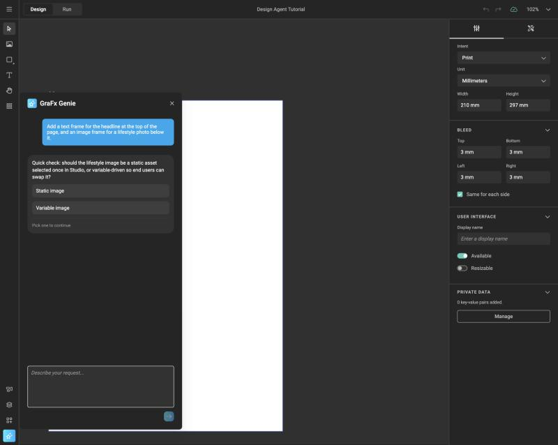
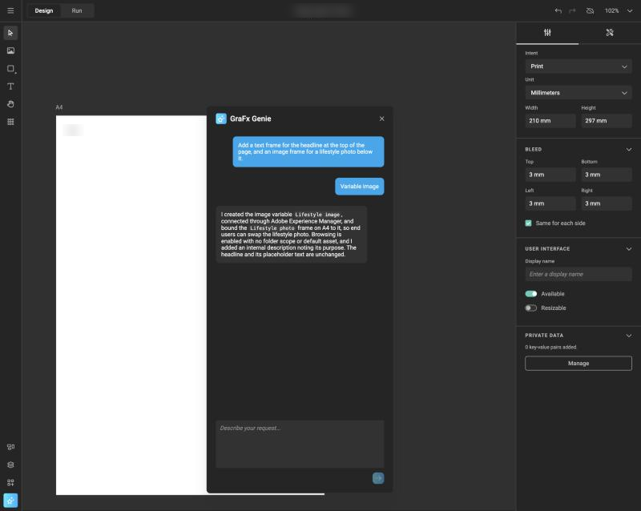
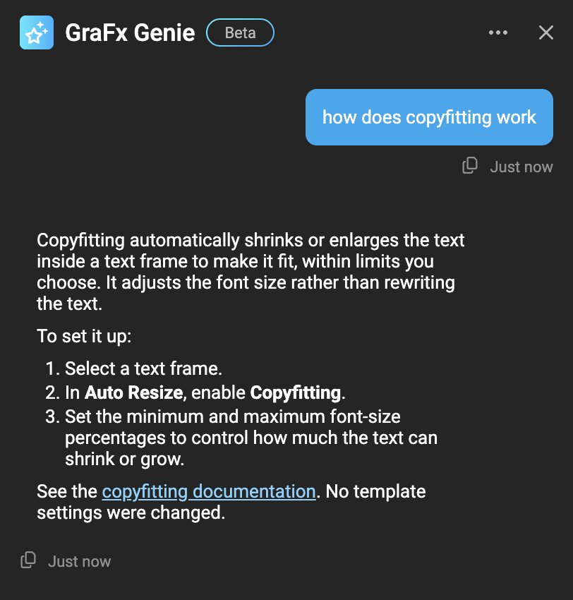

<!--
  GraFx Genie capability page — follows the GraFx Genie hub pattern:
  1. What it is  2. How GraFx Genie helps  3. Where to find it (links out)
  Design Agent has its own sub-section; this page is the concept + entry point.
-->

# Design Agent (Beta)

The GraFx Genie Design Agent is available in [Beta](/release-notes/feature-maturity/#maturity-how-finished-it-is).

## What it is

The **GraFx Genie Design Agent** is a chat inside the GraFx Studio workspace. You describe what you want to create or change in plain language, and the agent operates GraFx Studio for you: it reads the open template, asks when something is unclear, and applies the changes on the canvas while you watch.

Think of it as a design colleague who knows GraFx Studio inside out, works from your Brand Kit, and takes over the repetitive setup work: adding layouts, creating variables, writing Actions, wiring content, animating frames, restructuring a design for a new format. You stay in control. The agent produces the same kind of template you would have built by hand, not a locked or special artifact.

Three things to know before you start:

- **If you can do it in the interface, you can ask for it.** The agent's reach is the GraFx Studio workspace itself: layouts, pages, frames, text, variables, Actions, animation, Brand Kit, media, components, data sources, barcodes. The few things it cannot reach yet are listed under [known limitations](#known-limitations) below.
- **It only does what you ask.** The agent does not tidy up, optimize or add things on its own initiative. Ask for a plan if you want suggestions; ask for a change if you want a change.
- **It works as is, and works better with context.** On any template the agent can explain, change and build. The more it knows about your brand and your way of working, from [Brand Kit descriptions](/GraFx-Genie/design-agent/brand-kit-descriptions/), [variable descriptions](/GraFx-Studio/guides/template-variables/define/#description) and [custom skills](/GraFx-Genie/design-agent/skills/), the closer its first result is to what you meant.

{.screenshot-full}

## How GraFx Genie helps

Building a Design System in GraFx Studio is largely structural work. The creative already exists (imported from Adobe InDesign, Adobe Photoshop or Figma, or drawn in GraFx Studio itself); what takes time is turning it into something that produces hundreds of on-brand variants: deciding what becomes a variable, adding layouts per channel, anchoring frames so they resize well, adding logic for badges and toggles, connecting a data source.

The Design Agent does that work from a conversation. Big picture, it can:

- **Explain and troubleshoot.** Ask "what does this do?" about a template, an Action or a variable, why a frame is hidden, or how a Studio feature works. The agent reads the live document and, when it needs product knowledge, searches the GraFx documentation and links to the page it used.
- **Turn a design into a template.** Make frames editable as variables, lock what must not change, add toggles and conditions through Actions, link image frames to GraFx Media or a connected DAM, set up a data source for batch output.
- **Adapt a design to other formats.** Add layouts by name, canvas preset or custom size, rework the arrangement for a different proportion, make frames pin, stretch, grow or copyfit per layout, add animation to animated layouts.
- **Generate a design from scratch.** Starting from a Brand Kit, describe a page and the agent composes it: colors, text styles, media and components from the kit, placed on a layout of the size you asked for.
- **Follow your organization's rules.** Brand Kit element descriptions tell the agent when to use which color, image, style or component. Custom skills add your own guidelines and design-system guidance at environment level.
- **Warn you about dependencies.** Before it deletes something, the agent checks what refers to it, so "delete the old badge" warns you about the Action that uses it.

## Three ways to start

How much the agent can do unattended depends on what you give it:

1. **From scratch.** Open any template, or a blank one, and talk. The agent explains, changes and builds from the names and properties it finds in the document. Good for exploring, troubleshooting and quick edits.
2. **From a Brand Kit.** Import a Brand Kit with [descriptions](/GraFx-Genie/design-agent/brand-kit-descriptions/) on its colors, media, text styles and components. The agent now designs with your palette and picks the right element for the purpose: generating and adapting designs becomes on-brand by default.
3. **From a Brand Kit and custom skills.** Add [custom skills](/GraFx-Genie/design-agent/skills/) that describe your campaign formats, naming, image sources and rules. A request like "prepare this for the Spring campaign" now produces the same structure every time, the way your team would build it.

Most teams start at 1 to learn what the agent does, and move to 3 for the work they repeat.

## In this section

- [How a conversation works](#how-a-conversation-works) (below): turns, progress, questions, stopping and undo.
- [Tutorial: work effectively with the Design Agent](/GraFx-Genie/design-agent/tutorial/): a first session, and the habits that get good results.
- [Prepare your template](/GraFx-Genie/design-agent/template-setup/): how the agent reads a template, and how to set one up so the agent does good work, including a blank template for designing from scratch.
- [Brand Kit descriptions](/GraFx-Genie/design-agent/brand-kit-descriptions/): writing the descriptions that steer the agent's choice of colors, media, text styles and components.
- [Custom skills](/GraFx-Genie/design-agent/skills/): adding your own instructions in environment settings, with best practices.
- [What you can ask](/GraFx-Genie/design-agent/commands/): a reference of the commands and questions the agent understands, by area.
- [Guide: adapt an existing design](/GraFx-Genie/design-agent/adapt-a-design/) and [Guide: design from scratch](/GraFx-Genie/design-agent/design-from-scratch/): two worked examples.
- [Availability and usage](/GraFx-Genie/design-agent/manage/): the environment-level opt-out, roles, and usage.

## How a conversation works

### Open the chat

In the GraFx Studio workspace, click the **GraFx Genie** button at the bottom of the left sidebar to open the chat. The button is enabled once the template has finished loading; click it again to close the chat.

Use the **…** menu at the top of the chat to choose where the chat is shown:

- **Docked panel**: docked to the right of the workspace.
- **Floating panel**: a panel over the canvas that you can drag where you want.
- **New window**: a separate browser window, for example on a second screen.

Closing the chat does not end the conversation: reopen it and the thread is still there. To start over, choose **Clear chat history** in the **…** menu. This empties the thread, and GraFx Genie no longer uses any of the earlier conversation as context. Your template is not changed.

### Send a message

Type what you want and press ++enter++. ++shift+enter++ inserts a line break. While the agent is working, the thread shows *GraFx Genie is thinking* and the send button makes way for a **Stop** button; the reply streams in as it is written.

{.screenshot-full}

A message you send is a **turn**. A turn can involve several steps: the agent may read the document, measure a frame, apply a change, check the result and correct it before replying. For longer operations such as animating a layout, generating a design or writing an Action, the chat shows the stages of that work as they complete, so you know what is happening.

The ++up++ and ++down++ arrow keys walk through the prompts you sent earlier in the session, like a terminal: handy to repeat a command on another layout.

### The agent asks before guessing

When a request is ambiguous, the agent pauses and asks, often with choice chips you can click: which of two layouts with similar names, whether hiding a frame should reflow the rest of the layout, whether to reuse an existing variable group or create a new one, which data connector to use. Answer in the chat and the turn continues.

{.screenshot-full}

When the turn is done, the reply summarizes what was created or changed, naming the frames and variables involved, and the result is on the canvas.

{.screenshot}

Before destructive operations, such as deleting all child layouts or deleting a variable that an Action refers to, the agent reports what is affected and asks for confirmation first.

### Stop and undo

A **Stop** control is shown while a turn is running. One click ends the turn and puts your request back in the text box, so you can adjust and resend it. What already landed on the canvas stays; use undo for that.

Every turn is a **single undo step**. Whatever the agent changed in one turn, from one frame to a complete generated design, ++ctrl+z++ (++cmd+z++ on macOS) reverts it in one go. This also holds for a stopped turn.

If the connection to GraFx Genie goes silent, the chat retries once and then ends the turn with an error. Changes made before that stay on the canvas; undo reverts them. If a turn needs more steps than one turn allows, the chat shows a warning with a **Continue** option.

### Answers grounded in the documentation

When you ask how something works ("how do image variables work?", "what is the difference between layouts and pages?", "walk me through anchoring"), the agent searches the GraFx documentation (the CHILI GraFx, GraFx Studio, GraFx Brand Kits, GraFx Fonts, GraFx Media and GraFx Genie sections) before answering. The chat shows *Searching the documentation* and then *Writing the reply*. The reply links to the page it used, opening in a new tab, and says so when the documentation did not cover the question. A how-to question does not change the canvas; a request phrased as a question ("how do I get this red?") is treated as a request to make the change.

{.screenshot}

## What the Design Agent is not

The name suggests an agent that creates designs, and it can. Its main job, however, is to turn a design into a robust, repeatable template that a Design System can run on. It understands design because placing a QR code or reflowing a landscape layout requires it, not because it replaces the designer.

It also does not publish, approve or distribute anything, it does not alter the assets in your Brand Kit or GraFx Media, and it does not bypass the rules you built into a template. End users in [GraFx Experience](/GraFx-Experience/) never interact with the Design Agent: it lives in the GraFx Studio workspace and is available to users with a Template Designer seat.

### Known limitations

!!! warning "Known limitations in this beta"
    - Running the same prompt twice can give different results. Check the outcome on the canvas; the template is fully editable.
    - After a series of changes, the agent's picture of the template can lag behind the document. If an answer looks wrong, ask it to look again ("list the variables") or clear the chat history.
    - The agent sometimes creates a new variable or variable group where an existing one would do. Say explicitly which variable or group to reuse.
    - Vertical text alignment and baseline shift are not yet available to the agent, and the *Link to variable* option when configuring a data connector is not supported in chat.
    - Variable visibility conditions, connector metadata mapping and layout fill color are not exposed to the agent. It will tell you what it cannot reach when you ask for something outside its range.

## Where to find it

The Design Agent is part of **GraFx Studio**, in the template workspace. Availability is controlled per environment, see [Availability and usage](/GraFx-Genie/design-agent/manage/).

- [GraFx Studio](/GraFx-Studio/): the Smart Template editor the agent works in.
- [GraFx Brand Kits](/GraFx-Brand-Kits/): the source of truth the agent designs from.
- [GraFx Genie for Actions](/GraFx-Genie/concepts/actions/): the Action-writing capability the Design Agent relies on when it adds logic.
- [Use of AI in CHILI GraFx](/CHILI-GraFx/trust/AI/): how AI is governed on the platform.
