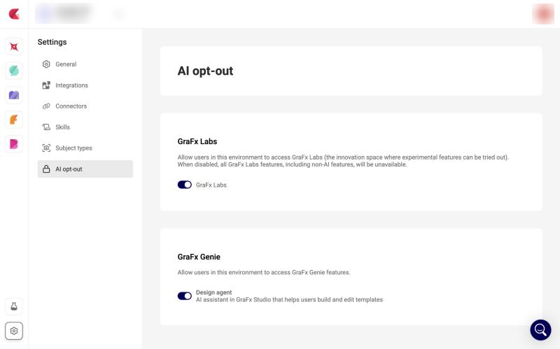

# Availability and usage

## Availability

The [Design Agent](/GraFx-Genie/design-agent/) is available in [Beta](/release-notes/feature-maturity/#maturity-how-finished-it-is) in the GraFx Studio template workspace, to users with a Template Designer seat. It carries a **Beta** label in the interface. The Design Agent is part of the product, not a [GraFx Labs](/CHILI-GraFx/concepts/grafx-labs/) experiment.

## Opt out per environment

Organizations that do not want AI features in a given environment can switch the Design Agent off.

1. Open the environment's **Environment settings**.
2. Go to **AI opt-out**.
3. Under **GraFx Genie**, switch **Design agent** off.

{.screenshot-full}

The toggle is on by default. When it is off, the Design Agent is hidden for every user in that environment, in the template and the component workspace. The same page holds the **GraFx Labs** toggle; the two are independent. GraFx Genie Vision (Smart Crop) and GraFx Genie for Actions are not affected by either toggle.

Only Subscription Admins and Environment Admins can change the opt-out, see [roles](/CHILI-GraFx/users/roles/).

## Who can use it

- **Use the chat:** anyone who can open a template in the GraFx Studio workspace, that is, users with a Template Designer seat.
- **Manage custom skills:** Subscription Admins and Environment Admins, in **Environment settings › Skills**. See [Manage skills](/CHILI-GraFx/guides/manage-skills/) and [custom skills](/GraFx-Genie/design-agent/skills/).
- **Manage Brand Kit descriptions:** anyone who can edit the Brand Kit in GraFx Brand Kits. See [Brand Kit descriptions](/GraFx-Genie/design-agent/brand-kit-descriptions/).

## Usage

AI calls count against the fair-use allowance of your subscription tier. During the Beta this is a soft, monitored limit; it is not enforced and there is no usage report in the Platform UI. Your Account Manager can tell you where you stand.
