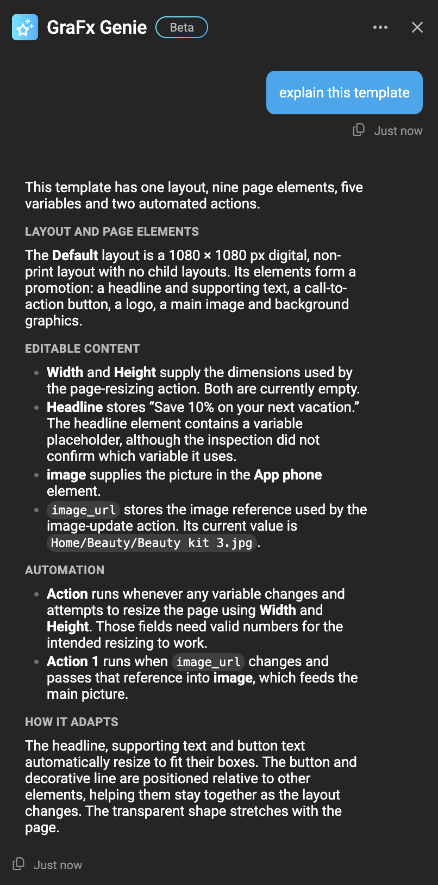

# Tutorial: work effectively with the Design Agent

This tutorial is a first session with the [Design Agent](/GraFx-Genie/design-agent/), on any template you have. It takes about twenty minutes and teaches the habits that make the agent useful: ask before you instruct, give it names and context, work in small turns, check the canvas, undo without hesitation. Nothing you do here is special; by the end you will have a feel for when to type and when to click.

If you want a finished outcome instead, follow one of the guides: [adapt an existing design](/GraFx-Genie/design-agent/adapt-a-design/) or [design from scratch](/GraFx-Genie/design-agent/design-from-scratch/).

## Before you start

- Open a template in the GraFx Studio workspace. A copy of a real one is ideal: something with a few layouts, variables and an Action or two.
- Click the **GraFx Genie** button at the bottom of the left sidebar to open the chat, and drag it to a spot where it does not cover what you are working on.

## 1. Let the agent explain the template

Start by asking, not instructing:

> Explain this template.

The reply walks through the variables and where they appear, the layouts, and the Actions as trigger → effect, in plain language.

{.screenshot-full}

Now pick something you are curious about:

> What does the *Toggle badge* action do?

> Why is the *Subhead* frame not visible on the Story layout?

The agent reads the live document, so this works on templates you did not build yourself. Use it as a first step on any unfamiliar template: it is faster than opening every panel, and it tells you the names you will use in the next steps.

**Habit:** when you do not know how something works, ask. A question never changes the canvas.

## 2. Make one small change

> Rename the *Text 3* frame to *Subhead*.

Watch the Layers panel update, then undo it with ++ctrl+z++ (++cmd+z++ on macOS) and watch it revert. Every turn is one undo step, however big. Redo it, or ask again.

**Habit:** try things. Undo is always one keystroke away, and a stopped or undone turn costs nothing.

## 3. Ask for a plan, then execute it

> What would you change to turn this into a template end users can use?

You get a proposal: which frames should become variables, what should be locked, where logic is needed. The agent does not act on its own proposal. Pick the parts you agree with and ask for them:

> Do the first three. Leave the price alone, it comes from the data source.

**Habit:** the agent does nothing you did not ask for. Suggestions come when you ask for them; changes come when you ask for them.

## 4. Use names, and give the agent context

> Make the headline editable.

If the template has one frame that looks like a headline, this works. If it has two, the agent asks which one, with chips to pick from. Answer, or rephrase with the name:

> Make the *Headline* frame editable.

Now give the agent something it cannot see on its own:

> Add a description to the *Headline* variable: "Campaign message, max two lines, shown on all layouts."

Descriptions on variables and on Brand Kit elements are how the agent knows the *purpose* of things, not only their names. The more of them a template has, the less you need to explain in each request. See [prepare your template](/GraFx-Genie/design-agent/template-setup/).

**Habit:** name what you mean. When the agent asks, answer with a name. When you find yourself explaining the same thing twice, write it down as a description or a [custom skill](/GraFx-Genie/design-agent/skills/).

## 5. Work in turns, check the canvas

> Add a 1080 × 1080 px digital layout called *Social square*.

Select the new layout in the Layouts panel and look at it. Then:

> On *Social square*, move the image to the top half and the copy to the bottom half.

Two turns, two undo steps, two chances to look. A single "add a social layout and rearrange it and animate it and make everything editable" works too, but when the result is half right you can only undo all of it.

**Habit:** one intention per message for anything you want to inspect; chain steps only when you are confident.

## 6. Stop, and continue

Ask for something long:

> Make this layout responsive.

The chat shows the stages: snapshot, anchors, test resizes, corrections. Click **Stop** halfway. The step in progress finishes, nothing more starts, and your request is back in the text box. What landed stays; undo removes it if you want. Press ++up++ to recall the prompt, edit it, send it again.

**Habit:** stop when you see it going the wrong way. It is never an error.

## 7. Mix chat and hands

Drag a frame a few millimetres by hand. Change a color in the properties panel. Then ask the agent to continue from there:

> Align the subhead with the headline's left edge.

The agent reads the document as it is now, including your manual edits. There is no mode to switch, no handover. Use whichever is faster for the step at hand: the chat for anything structural or repetitive, your hands for a nudge.

**Habit:** the agent is a colleague at the same desk, not a separate tool.

## 8. Ask what changed

> What did you change in this session?

A recap you can paste into a handover note or a ticket.

## What to do next

- Give the agent context once, so every session starts further ahead: [Brand Kit descriptions](/GraFx-Genie/design-agent/brand-kit-descriptions/) and [custom skills](/GraFx-Genie/design-agent/skills/).
- Keep [What you can ask](/GraFx-Genie/design-agent/commands/) open the first few times; it lists what the agent understands, by area.
- Keep an eye on the [release notes](/release-notes/); the Beta changes often.
