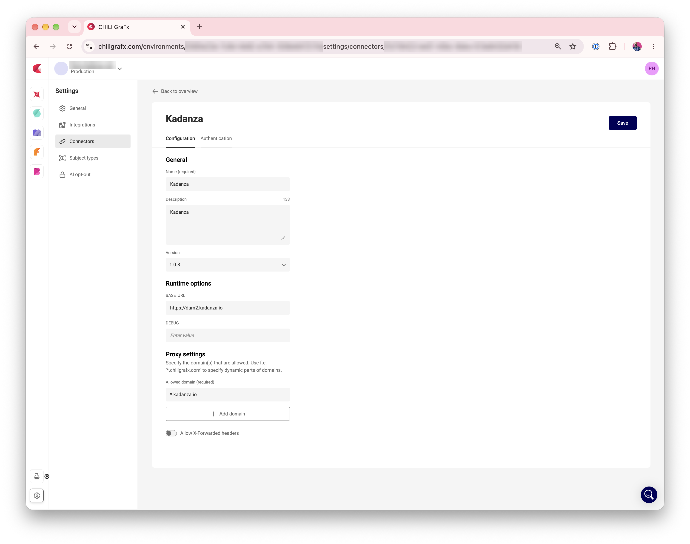
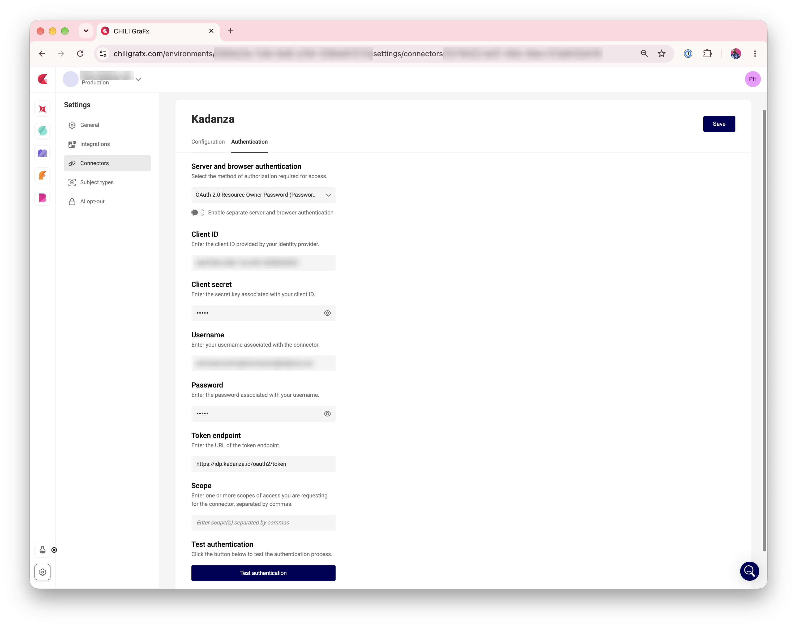
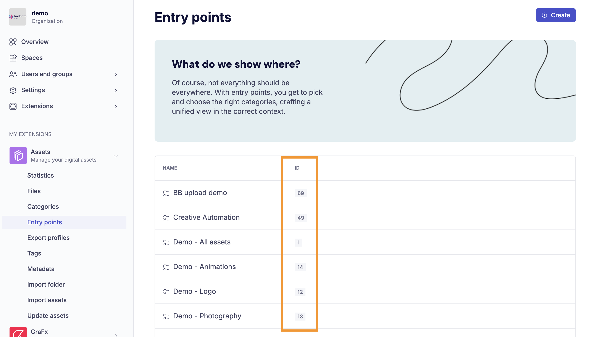
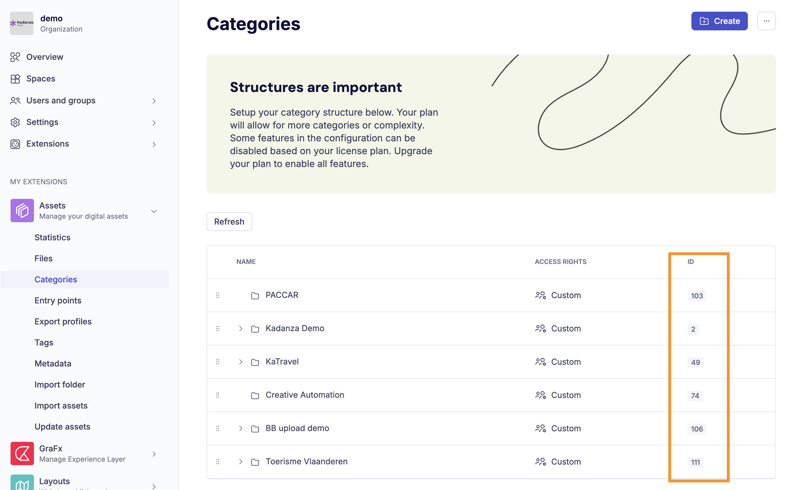

# Media Connector for Kadanza DAM

:fontawesome-regular-square: Built-in  
:fontawesome-regular-square: Built by CHILI publish  
:fontawesome-regular-square-check: Third Party

[See Connector Types](/GraFx-Studio/concepts/connectors/#types-of-connectors)

The Kadanza DAM connector lets you browse, search, and place assets from your Kadanza DAM directly in GraFx Studio. Template designers can limit the assets end users see to specific categories, and map Kadanza custom metadata to template variables.

## Solution vendor website

See [Kadanza's website](https://www.kadanza.com/)

## Installation

The installation is done by enabling the Kadanza connector in your environment.

[See Installation Through Connector Hub](/GraFx-Studio/guides/connector-hub/)

## Kadanza Configuration

Contact your Kadanza DAM administrator or [Kadanza](https://www.kadanza.com/) to obtain the correct values for the fields below.

## CHILI GraFx Connector Configuration

From the Environments overview, click **Settings** next to the environment where you want to install or configure the connector.

Then click the installed connector to access the configuration.

### Configuration

Your instance of the connector needs to know which Kadanza DAM instance it should communicate with and how to authenticate.

{.screenshot-full}

**BASE_URL**

The URL of your Kadanza DAM instance. For most customers, this is:

```html
https://dam2.kadanza.io
```

If your organization has a dedicated Kadanza DAM instance, the URL is different. Your Kadanza DAM administrator will provide you with the correct value.

**DEBUG**

Leave this empty for normal use. When set to any value, the connector writes detailed request information to the browser console. This is useful when troubleshooting with Kadanza or CHILI publish support.

**Proxy settings**

CHILI GraFx needs to know which domains are allowed.

For example:

```html
*.kadanza.io
```

### Authentication

Select your type of authentication. The Kadanza connector supports:

- **OAuth 2.0 Resource Owner Password** — for **Server** and **Browser**. The connector signs in to Kadanza DAM with one fixed account, such as a service account. Every user sees the assets that account has access to.
- **OAuth 2.0 Authorization Code** — for **Browser** only. Each user signs in with their own Kadanza account, so they see only the assets they are allowed to access in Kadanza DAM.

By default, server and browser use the same authentication. Turn on **Enable separate server and browser authentication** to set them up differently.

{.screenshot-full}

**OAuth 2.0 Resource Owner Password**

- **Client ID** and **Client secret**: provided by your Kadanza DAM administrator.
- **Username** and **Password**: the Kadanza account the connector signs in with.
- **Token endpoint**:

```html
https://idp.kadanza.io/oauth2/token
```

- **Scope**: leave empty, unless your Kadanza DAM administrator tells you otherwise.

**OAuth 2.0 Authorization Code**

You need the **Client ID**, **Client secret**, token endpoint, and authorization endpoint from your Kadanza DAM administrator. The client credentials can be sent either as a Basic authorization header or in the request body.

Because Authorization Code is browser-only, use Resource Owner Password for **Server** authentication. The credentials you set there determine which assets are available when CHILI GraFx generates output.

Use **Test authentication** to check your settings before you save.

See [Authorization for Connectors](/GraFx-Developers/connectors/authorization-for-connectors/) for more details on each authorization type.

## Using Assets from Your Kadanza DAM

### Place Assets in Your Template

- Open **Resources** > **Media** in GraFx Studio.
- Select the Kadanza connector.
- Double-click an asset to assign it to the selected image frame.

The connector offers these file types: AI, EPS, JPG/JPEG, PDF, PNG, PSD, and TIF/TIFF. Assets are listed by their title in Kadanza DAM.

!!! note "TIFF files in output"
    For TIFF files, the connector uses the preview image that Kadanza DAM generates, also for output. For print output with full resolution, use PDF, PNG, or JPG assets.

### Image Variables

When using [image variables](/GraFx-Studio/guides/template-variables/assign/#assign-template-variable-to-image-frame), you will see the same grid of assets when selecting an image, unless you have set configuration options (see below).

### Metadata mapping

The connector exposes the custom metadata fields defined in your Kadanza DAM. Text, number, and true/false values can be mapped to template variables.

See [Concept of metadata mapping](/GraFx-Studio/concepts/connectors-media/#concept-2-making-assets-available-and-exposing-metadata) for more details.

### Configuration Options

Kadanza DAM organizes assets in **categories**, which work like folders and can contain subcategories. An **entry point** (called a category group in the connector settings) bundles one or more top-level categories.

To control which assets template users are offered, set one or more of these options on the image variable. Each value can be fixed, or linked to another variable.

#### Category group (entrypoint) ID

When set, users start at the top-level categories of this entry point, shown as folders. They can browse into each category and its subcategories.

A search started at the top level searches all categories in the entry point, including subcategories. A search started inside a category searches that category only.

#### Category ID

When set, users start inside this category. They see its subcategories as folders, followed by the assets in the category itself.

A search searches the current category only, not its subcategories.

If both **Category group (entrypoint) ID** and **Category ID** are set, the entry point is used.

#### Find the IDs

Kadanza DAM administrators can find the IDs in the Kadanza DAM **Admin console**, under **Assets**:

- **Entry points**: the **ID** column shows the ID to use for **Category group (entrypoint) ID**.

{.screenshot-full}

- **Categories**: the **ID** column shows the ID to use for **Category ID**.

{.screenshot-full}

!!! tip "No category set"
    When neither option is set, users see one flat list of all assets they have access to, without folders.

#### Search query

Defines how the text a user types in the search field is passed to Kadanza DAM. Use the `<search_input>` placeholder where the typed text should go.

For example, to search all fields:

```html
_all:<search_input>
```

When a user types `shoe`, the connector searches Kadanza DAM for `_all:shoe`.

The search query only applies when the user types in the search field. When it is not set, the typed text is used as a plain search.

For the right search syntax, consult your Kadanza DAM administrator.
