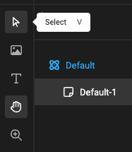

# Sidebar (top section)

<!-- TODO screenshot (REL-80): retake — the sidebar now includes the Pen tool; confirm its position in the list below against the retake -->
{.screenshotsmall}

Tools to interact with the page or document.

From top to bottom

- Select (V)
- Image (I)
- Shapes > Rectangle (R)
- Shapes > Ellipse (E)
- Shapes > Polygon (Y)
- Pen (P)
- Text (T)
- Hand (H)
- Zoom (Z)

When your cursor is not IN a text frame, you can use the shortcuts mentioned next to the  tool to switch tools.

{.screenshotsmall}

## Select

To select frames or elements on the document or page

## Image

To create a frame to hold media assets

## Shapes

To create a frame to hold a shape.

## Pen

To draw a custom shape, or edit the path of a shape or an image clipping mask. See [Draw a custom shape with the Pen tool](/GraFx-Studio/guides/shape-frame/#draw-a-custom-shape-with-the-pen-tool).

## Text

To create a frame to hold type or text

## Hand

Tool to move the page around on the canvas

## Zoom

Zoom in or out

Click to zoom in

Alt-click to zoom out

